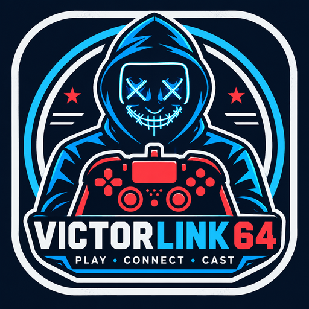

<p align="center">
  
</p>

<h1 align="center">VictorLink64</h1>

<p align="center"><b>PLAY • CONNECT • CAST</b></p>

<p align="center">
  Your classic N64 and Super Nintendo games, a built-in chess board,<br>
  and friends to play with — near or far. All in one Android app.
</p>

<p align="center">
  <a href="https://github.com/Victorious93/VictorLink64/releases"></a>
  
  <a href="gpl-license"></a>
</p>

<p align="center">
  <a href="https://github.com/Victorious93/VictorLink64/releases">
    
  </a>
  <br>
  <sub>Grab the newest <code>.apk</code> from the Releases page.</sub>
</p>

> **Heads up — this is an early beta.** Everything below is brand new. Some features have only been
> tried on a computer, not yet on many real phones, so expect a few rough edges. Feedback is very welcome!

---

## ✨ What you can do

- 🎮 **Play N64 and Super Nintendo games** — open your own game files and play them right away.
- ♞ **Built-in chess** — play against your phone (Easy to Expert) or pass the phone to a friend.
- 🌍 **Play friends anywhere** — create an online room and share a 6-letter code. They type it in, you're connected.
- 📶 **Play friends nearby** — on the same Wi-Fi, or over Bluetooth with no internet at all.
- 🕹️ **Bluetooth controllers** — pair a gamepad and play like a console.
- 👆 **Touch controls** — on-screen buttons when you don't have a controller.
- 💾 **Save states** — save anywhere and pick up exactly where you left off.
- 💙 **A fresh look** — dark navy design with neon blue and red, made just for VictorLink64.

## 🚀 Coming soon

- 📺 **Cast to TV** — send your game to the big screen.
- 🤝 **Play N64 & SNES games together online** — today online play works for chess; retro games are next.

## 🏁 How to get started

1. **Download** the latest `.apk` from the [Releases page](https://github.com/Victorious93/VictorLink64/releases) on your Android phone.
2. **Allow the install** — Android will ask to let your browser or file app "install unknown apps". Say yes for this one.
3. **Pick your game folder** — open VictorLink64, tap **Pick folder** and choose where your game files are saved.
4. **Play!** Tap a game to start, or tap **Chess** for a quick match. Want to play with a friend? Open the **Connect** tab.

## ❓ FAQ

**Is it free?**
Yes. VictorLink64 is free and open source. No ads, no subscriptions.

**Are games included?**
No. VictorLink64 doesn't come with any games. Use your own game files that you legally own
(for example, backups of your own cartridges). Chess is built in and ready to play.

**Is it safe?**
The full source code is public right here, so anyone can check what it does. Only download the app from this
page's [Releases](https://github.com/Victorious93/VictorLink64/releases). The app only asks for permissions it
needs — your game folder, and Bluetooth/Wi-Fi when you choose to play with friends nearby.

**Which phones work?**
Android 9 or newer. Newer phones run games more smoothly.

**Something doesn't work?**
Please [open an issue](https://github.com/Victorious93/VictorLink64/issues) and tell us your phone model and what happened.

---

<details>
<summary><b>🛠️ For developers</b></summary>

<br>

Requirements: JDK 21, Android SDK (API 36), NDK `26.1.10909125`, CMake `3.22.1`.

```bash
git clone https://github.com/Victorious93/VictorLink64.git
cd VictorLink64
echo "sdk.dir=/path/to/android-sdk" > local.properties
./gradlew assembleDebug            # APK → app/build/outputs/apk/debug/VictorLink64-debug.apk
./gradlew :app:testDebugUnitTest   # chess engine (perft) + connect tests
```

- App UI: Kotlin + Jetpack Compose in `app/src/main/java/org/victoriousframework/victorlink64/`
  (`ui/` home & library, `chess/` engine + AI, `connect/` multiplayer, `snes/` SNES player).
- N64 emulation: Mupen64Plus core and plugins (native modules in this repo).
- SNES emulation: prebuilt bsnes libretro core in `app/src/main/jniLibs` — rebuild with `scripts/build-bsnes.sh`.
- Online relay: Cloudflare Worker + Durable Object in `server/relay` (`npx wrangler deploy`).
- Icons: regenerate from `assets/logo.png` with `scripts/gen_icons.py`.
- More: [`BUILDING.md`](BUILDING.md), [`ARCHITECTURE.md`](ARCHITECTURE.md), [`docs/NETPLAY.md`](docs/NETPLAY.md).

</details>

## 🙏 Credits & License

VictorLink64 is made by **Don Victor** ([Victorious93](https://github.com/Victorious93)).

It stands on the shoulders of amazing open-source projects:

- **[Mupen64Plus](https://github.com/mupen64plus) / [Mupen64Plus-AE](https://github.com/mupen64plus-ae/mupen64plus-ae)** — N64 emulation (GPL v3)
- **[bsnes](https://github.com/libretro/bsnes)** by byuu and contributors — Super Nintendo emulation (GPL v3)

The chess engine, multiplayer, and app screens are original VictorLink64 code.
VictorLink64 is licensed under the **GNU General Public License v3** — see [`gpl-license`](gpl-license).

<sub>Nintendo 64 and Super Nintendo are trademarks of Nintendo. VictorLink64 is not affiliated with or endorsed by Nintendo.</sub>
