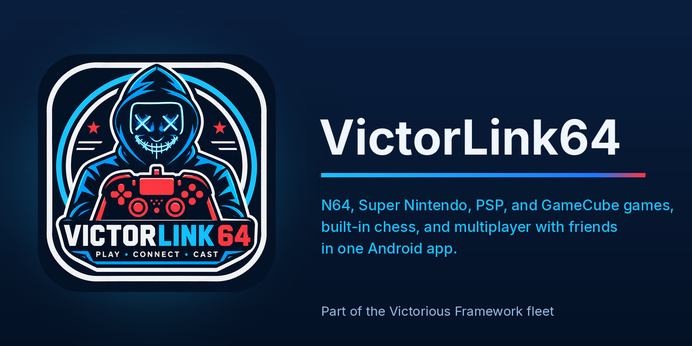

<div align="center">



# VictorLink64

**N64, Super Nintendo, PSP, and GameCube games, built-in chess, and multiplayer with friends — in one Android app.**

Works on its own; fleet integration (droidcommand-AI) is optional

<p>
  <a href="https://github.com/Victorious93/VictorLink64/releases"></a>
  <a href="gpl-license"></a>
  <a href="https://github.com/Victorious93/VictorLink64/actions/workflows/build.yml"></a>
  <a href="https://victorious-framework.pages.dev"></a>
  <a href="#coming-soon"></a>
</p>

</div>

## Features

- **N64 and Super Nintendo** — open your own game files and play. N64 uses Mupen64Plus; Super Nintendo uses bsnes, with size modes, multi-touch controls, and save/load states.
- **PSP and GameCube** — library support for PSP (`.iso`, `.cso`, `.pbp`) and GameCube (`.iso`, `.gcm`, `.rvz`, `.ciso`) files, using PPSSPP and Dolphin. These consoles are new and **have not yet been tested on a real phone**, so a game may fail to start until that work is finished.
- **Import games as they are** — add single files or a whole folder; zip, 7z, RAR, tar, gz and xz archives are read directly (no unzipping), and N64, SNES, PSP and GameCube formats are recognised automatically. Details and test status: [`docs/IMPORT.md`](docs/IMPORT.md).
- **PlayStation 2 (new, not yet device-tested)** — plays PS2 discs (`.iso`, `.chd`, `.cso`, `.bin`/`.cue`) with the LRPS2 core on 64-bit ARM phones. You supply your own PS2 BIOS (Settings → PlayStation 2); DualShock 2 touch controls; picture size from Native to about 1080p. PS2 is very heavy: expect it to be slow on entry-level phones. See [`docs/PS2.md`](docs/PS2.md).
- **Built-in chess** — play the phone (Easy to Expert) or pass the phone to a friend.
- **VictorOps Zombies** — a built-in top-down wave shooter. Play solo from the Library tab, or co-op with a friend from the Connect tab (2 players over Bluetooth). Co-op is new and **has not yet been tested on real devices**; see [`docs/ZOMBIES.md`](docs/ZOMBIES.md).
- **PC Streaming** — play games from your own PC on the phone over Wi-Fi: finds PCs running Sunshine (or GeForce GameStream) on your network or takes an IP address, pairs with a PIN, lists the PC's apps and streams them with resolution / frame rate / quality settings, an on-screen controller, and real-controller passthrough. Streaming core is Moonlight (GPL-3.0, see [`NOTICE`](NOTICE) and [`moonlight/README.md`](moonlight/README.md)). **Compiled and run on an emulator against a fake host only; not yet tested against a real PC.**
- **Online rooms** — create a room and share its 6-character code; friends enter it to join.
- **Nearby play** — over the same Wi-Fi, or over Bluetooth with no internet.
- **APK Player (early beta, new)** — pick an Android `.apk`, see in plain language whether your phone can run it, and launch it in a private sandbox without installing it. Old 32-bit apps run through a small companion app, *VictorLink64 32-bit Helper*. The file intake, status messages and helper hand-off were checked on emulators; the sandbox engine is **compiled only and not device-tested**, 64-bit-only phones are **not supported yet**, and the helper is sideload-only (not for Google Play). See [`docs/APK-Player-Design.md`](docs/APK-Player-Design.md) and the [device checklist](docs/APK-Player-Device-Test-Checklist.md).
- **Bluetooth controllers and touch controls** — pair a gamepad (remap its buttons in Settings → Controller buttons) or use the on-screen controls: analog stick (fixed or floating), analog GameCube triggers, slide D-pad, console-accurate layouts for N64, SNES, PSP and GameCube, an in-game layout editor, haptics, and auto-hide when a controller connects. New and **not yet device-tested**; see [`docs/CONTROLS.md`](docs/CONTROLS.md).
- **Save states** — save anywhere and resume later.
- **Graphics & performance** — picture quality per emulator (resolution, filtering, anti-aliasing, widescreen, texture upscaling, screen effects), **Auto Best Settings** on by default that picks what your phone can run at full speed and remembers it per game, an FPS counter, and optional [Shizuku](https://shizuku.rikka.app/) boosts. New and **not yet device-tested**; see [`docs/GRAPHICS.md`](docs/GRAPHICS.md).
- **Classic Android check** — a Settings screen that reports whether this phone can run old 32-bit Android apps. It is a diagnostic only; the player for those apps is not built yet.

> **Early beta.** Most features have not yet been tested on many real devices, so expect rough edges. Casting to a TV and online play for console games are not implemented yet; online play currently covers chess and VictorOps Zombies.

## Coming soon

> **Status as of 2026-11-18.** Most items below are now in the source code (merged into `main`) and build in CI, but **none has been tried on a real phone yet**, and none is in a downloadable release. The `v0.3.2-debug` release APK does not include them. Treat "merged" as "written and compiled", not "works".

| Feature | What it means for you | Where it stands |
| --- | --- | --- |
| **Top-quality touch controls for every console** | Better on-screen buttons, sticks, and triggers for every console, plus controller remapping. | Merged, not in a release, not tried on a phone |
| **Sharper graphics, up to 1080p** | Picture-quality options per console, filters and shaders, and **Auto Best Settings** that picks settings for your phone. Not available for PS2 yet (it has its own picture-size setting). | Merged, not in a release, not tried on a phone |
| **Optional Shizuku tweaks** | If you already use the Shizuku app, extra phone-level tweaks to help games run better. You never need it to play. | Merged, not in a release, not tried on a phone |
| **Stream games from your own PC** | Play games from your own computer on your phone over your home network, using Moonlight and Sunshine. | Merged; never tested against a real PC |
| **Add games in any format** | Open games stored as zip, 7z, rar, tar, and more, read straight from the file with no unpacking first. PS2 discs work only as plain files, not inside archives. | Merged, not tried on a phone |
| **APK Player (early)** | Run an Android APK in a private sandbox through a separate 32-bit helper app, without installing the APK. Needs a phone with 32-bit support; 64-bit-only phones are not supported yet. | Merged; the container engine has never started an app |
| **PlayStation 2** | Play PS2 discs with the LRPS2 core. You add your own PS2 BIOS. | Merged; the core has never been run on a device |
| **Play PC games on your phone** | Run Windows PC games on the phone, in the style of Winlator. | Planned |
| **PlayStation Vita** | An emulator for PlayStation Vita games. | Planned |

Merged items are also described under **Features** with their test status. An item leaves this table once it has been tested on a real phone and shipped in a release. Until then, treat this list as a progress report, not a promise.

## Screenshots

No official screenshots are in the repository yet.

## Install / download

Releases are currently **debug / pre-release** builds — not finished software. Install only if you understand the risk, and only from this repository's Releases page.

The latest GitHub Release (verified November 16, 2026) is tag [`v0.3.2-debug`](https://github.com/Victorious93/VictorLink64/releases/tag/v0.3.2-debug):

- APK: [`VictorLink64-0.3.2-debug.apk`](https://github.com/Victorious93/VictorLink64/releases/download/v0.3.2-debug/VictorLink64-0.3.2-debug.apk) (about 102 MB)
- All releases: <https://github.com/Victorious93/VictorLink64/releases>

That APK was published October 15, 2026. It does **not** include later work now in this repository, such as PSP, GameCube, the Classic Android check, or the newer on-screen button layouts. To try the current source, build from source below.

**On your phone (Android 9 or newer):**

1. Download the `.apk` from the link above.
2. Allow installing from unknown apps when Android asks.
3. Open the downloaded file to install.
4. Open VictorLink64, tap **Pick folder**, and choose the folder that holds your game files.
5. Tap a game to play, or tap **Chess** for a quick match. To play with a friend, open the **Connect** tab.

VictorLink64 does not include any games. Use game files you legally own, such as backups of your own cartridges or discs.

## Build from source

Requirements:

- JDK 21
- Android SDK with platform `android-36` and build-tools `36.0.0`
- NDK `26.1.10909125` and CMake `3.22.1`
- `gawk` and `file` on the host (the native build fails without `gawk`)

```bash
sdkmanager "platforms;android-36" "build-tools;36.0.0" "ndk;26.1.10909125" "cmake;3.22.1"

git clone https://github.com/Victorious93/VictorLink64.git
cd VictorLink64
echo "sdk.dir=/path/to/android-sdk" > local.properties

./gradlew assembleDebug
```

The APK is written to `app/build/outputs/apk/debug/VictorLink64-debug.apk`. The application id is `org.victoriousframework.victorlink64`. The first native build covers four ABIs and takes several minutes. Run only one Gradle build per checkout at a time.

Release signing keys are never committed to this repository.

Run the tests:

```bash
./gradlew :app:testDebugUnitTest                      # chess engine, connect and Zombies adapter tests
./gradlew :zombies:test                                # VictorOps Zombies game tests
python3 -I -m unittest discover -s scripts/tests -v   # APK payload verifier tests
```

Project layout:

| Path | Contents |
| --- | --- |
| `app/src/main/java/org/victoriousframework/victorlink64/` | Kotlin and Compose UI: `ui/`, `chess/`, `connect/`, `snes/`, `zombies/`, `hw/`, `classic/` |
| `zombies/` | VictorOps Zombies game core (Kotlin + libGDX, JVM module) — see [`zombies/README.md`](zombies/README.md) |
| `mupen64plus-*` | N64 emulator core and plugins (native modules) |
| `app/src/main/jniLibs` | Prebuilt libretro cores: bsnes (several ABIs), plus PPSSPP and Dolphin (`arm64-v8a`) |
| `server/relay` | Cloudflare Worker and Durable Object for online rooms (`npx wrangler deploy`) |

More detail: [`BUILDING.md`](BUILDING.md), [`ARCHITECTURE.md`](ARCHITECTURE.md), [`TESTING.md`](TESTING.md),
[`docs/NETPLAY.md`](docs/NETPLAY.md).

## License

Licensed under the **GNU General Public License v3** — see [`gpl-license`](gpl-license).

## Credits

VictorLink64 is made by Don Victor ([Victorious93](https://github.com/Victorious93)) and builds on these open-source projects:

- [Mupen64Plus](https://github.com/mupen64plus) and [Mupen64Plus-AE](https://github.com/mupen64plus-ae/mupen64plus-ae) — N64 emulation (GPL v3). Upstream's original README is kept in [`UPSTREAM-README.md`](UPSTREAM-README.md).
- [bsnes](https://github.com/libretro/bsnes) by byuu and contributors — Super Nintendo emulation (GPL v3)
- [PPSSPP](https://github.com/hrydgard/ppsspp) by Henrik Rydgård and contributors — PSP emulation (libretro core)
- [Dolphin](https://github.com/libretro/dolphin) by the Dolphin Emulator Project and contributors — GameCube emulation (libretro port, GNU GPL v2.0 or later)
- [libGDX](https://github.com/libgdx/libgdx) — game framework for VictorOps Zombies (Apache-2.0)
- [NewBlackbox / BlackBox](https://github.com/ALEX5402/NewBlackbox) — container core of the optional 32-bit helper (Apache-2.0, modified; see [`NOTICE`](NOTICE))
- [Shizuku API](https://github.com/RikkaApps/Shizuku-API) by RikkaApps — optional performance boosts (Apache-2.0)

The chess engine, multiplayer, VictorOps Zombies, and app screens are original VictorLink64 / Victorious Framework code.

Upstream trademarks and product names remain their owners'.

## FAQ

**Is it free?** Yes. It is free and open source, with no ads or subscriptions.

**Something doesn't work?** Please [open an issue](https://github.com/Victorious93/VictorLink64/issues) with your phone model and what happened.

<sub>Nintendo 64, Super Nintendo, and GameCube are trademarks of Nintendo. PlayStation Portable (PSP), PlayStation 2, and PlayStation Vita are trademarks of Sony. VictorLink64 is not affiliated with or endorsed by Nintendo or Sony.</sub>
